# SnipShape Screen Capture and Annotation Tool

**SnipShape** is a lightweight screen-capture utility written in
**AutoHotkey 2.1**. It provides an alternative to the Windows Snipping Tool while
using far fewer system resources (~2MB when idle).

The tool captures a screen region and immediately displays it as an **overlay
GUI positioned directly over the captured area**. This overlay can be edited in
place using annotation and shape tools, allowing you to quickly highlight or
mark up the captured content without opening additional windows.

Editing works differently from most editors: moving the cursor over a shape
shows its focus rectangle, and you can move or resize it right away without
clicking on it first.

It has full Undo/Redo, and saves PNG files with sidecar data to allow round-trip
editing, while still preserving the normal PNG screenshot/annotation data for use
in other applications.

SnipShape was originally based on the AutoHotkey **Snipper** concept of keeping
the editing surface directly on the screen rather than moving the image to a
separate editor or clipboard. Powerful annotation tools are provided to further
mark up the snip.

- [SnipShape Screen Capture and Annotation Tool](#snipshape-screen-capture-and-annotation-tool)
  - [Credits](#credits)
  - [Requirements](#requirements)
  - [Installation](#installation)
    - [Ready-to-run (no AutoHotkey needed)](#ready-to-run-no-autohotkey-needed)
    - [From the source](#from-the-source)
  - [Snipping Overview](#snipping-overview)
    - [Snip Annotation Examples](#snip-annotation-examples)
    - [One step capture - hold down activation keys](#one-step-capture---hold-down-activation-keys)
    - [Two Step capture - Hotkey to initiate snipping, then click-drag to select, similar to the built-in snipper](#two-step-capture---hotkey-to-initiate-snipping-then-click-drag-to-select-similar-to-the-built-in-snipper)
    - [While dragging the mouse to create a snip](#while-dragging-the-mouse-to-create-a-snip)
    - [Other snipping actions that don't use the mouse](#other-snipping-actions-that-dont-use-the-mouse)
    - [Hotkeys on Snip Surface](#hotkeys-on-snip-surface)
      - [Copying and saving](#copying-and-saving)
      - [Dragging a snip into another app](#dragging-a-snip-into-another-app)
  - [Toolbar - F1 to toggle while snip active, Sample ShapeBars shown on right](#toolbar---f1-to-toggle-while-snip-active-sample-shapebars-shown-on-right)
    - [Show or hide the toolbar](#show-or-hide-the-toolbar)
    - [Use toolbar buttons](#use-toolbar-buttons)
    - [Picture shapes (stickies)](#picture-shapes-stickies)
    - [Toolbar behavior](#toolbar-behavior)
    - [Shape bar](#shape-bar)
      - [Defaults for new shapes, or just the selected shapes](#defaults-for-new-shapes-or-just-the-selected-shapes)
      - [Using the bar](#using-the-bar)
  - [Drawing on snips](#drawing-on-snips)
    - [Snip Hotkeys to create shapes](#snip-hotkeys-to-create-shapes)
  - [Arrow shapes](#arrow-shapes)
  - [Shape tools](#shape-tools)
  - [Freehand drawing](#freehand-drawing)
  - [Highlighters](#highlighters)
  - [Redaction and obscuring](#redaction-and-obscuring)
  - [Text tools - Text is entered via a dialog box allowing you to set text options](#text-tools---text-is-entered-via-a-dialog-box-allowing-you-to-set-text-options)
    - [Callouts](#callouts)
  - [Colors](#colors)
  - [Snip Tools](#snip-tools)
    - [Toolbar Menus to create shapes](#toolbar-menus-to-create-shapes)
      - [Arrow Shapes](#arrow-shapes-1)
      - [Line/Connector/Rectangle/Ellipse Shapes/Bracket](#lineconnectorrectangleellipse-shapesbracket)
      - [Free pen shapes](#free-pen-shapes)
      - [Highlighter shapes](#highlighter-shapes)
      - [Redact/Obfuscate shapes](#redactobfuscate-shapes)
      - [Text shapes (text/tag/fill/outline/arrow text), Text entered via a dialog box.](#text-shapes-texttagfilloutlinearrow-text-text-entered-via-a-dialog-box)
      - [Tool menu](#tool-menu)
      - [Color menu, LMB to select color, RMB to customize color](#color-menu-lmb-to-select-color-rmb-to-customize-color)
    - [Drawing/Resizing Shapes](#drawingresizing-shapes)
    - [Reshaping shapes (control points)](#reshaping-shapes-control-points)
  - [Hovering and Focus Rectangle](#hovering-and-focus-rectangle)
    - [Selecting a shape](#selecting-a-shape)
    - [Hotkeys on Shapes](#hotkeys-on-shapes)
    - [Text / Graphics](#text--graphics)
    - [Moving Shapes](#moving-shapes)
    - [Deleting Shapes](#deleting-shapes)
    - [Resizing Shapes](#resizing-shapes)
    - [Clicking on Shapes](#clicking-on-shapes)
    - [Selecting a group of shapes](#selecting-a-group-of-shapes)
  - [Tray Menu options](#tray-menu-options)
  - [Configuration Files](#configuration-files)
  - [Limitations/Future](#limitationsfuture)

## Credits

Fanatic Guru / SKAN / iseahound / Descolada plus
the work of dozens of people inspired this script.
Additional contributors are referenced in the source code.

| Script            | Link                                                            |
| ------------------| --------------------------------------------------------------- |
| Screen Clipping   | <https://www.autohotkey.com/boards/viewtopic.php?f=6&t=12088>   |
| GDIp              | <https://www.autohotkey.com/boards/viewtopic.php?t=72011>       |
| Snipper           | <https://www.autohotkey.com/boards/viewtopic.php?f=83&t=115622> |
| UWP OCR Library   | <https://github.com/Descolada/OCR>                             |
| Thqby JSON Library | <https://github.com/thqby/ahk2_lib/blob/master/JSON.ahk>     |
| Mcode Forge       | <https://github.com/Vedette1/MCF.ahk>                          | 

## Requirements

- **AutoHotkey 2.1 Alpha 29** or later (some 2.1 features are used, including **structures**)
- **Windows 8 or later** to support child layered windows

## Installation

### Ready-to-run (no AutoHotkey needed)

Download [SnipShapeUnZip.zip](https://github.com/wilkster/SnipShape/releases/latest/download/SnipShapeUnZip.zip)
from the latest release, extract it to a local folder, and run `SnipShape.exe`. The zip holds the compiled program
with its `Cursors` and `Stickies` folders. Earlier versions are on the
[Releases](https://github.com/wilkster/SnipShape/releases) page.

### From the source

1. Clone or download a zip of the repository to a local folder.
2. Extract the files to a local folder.
3. If you have ahk2 associated with AutoHotkey 2.1 alpha, then just click on the
`SnipShape.ahk2` file in the base folder. You may rename SnipShape.ahk2 to
SnipShape.ahk or something else if you are using a different file
association. Do not rename the other **AutoHotkey** files, as they are referenced in
include files.

A tray icon like this  will appear. You may have to unhide it in the tray if it is initially hidden by Windows.

- **Left-click**: Opens the SnipShape menu
- **Right-click**: Opens the default AutoHotkey menu

Additional tray icon options are shown in [Tray Menu Options](#tray-menu-options).

## Snipping Overview

### Snip Annotation Examples
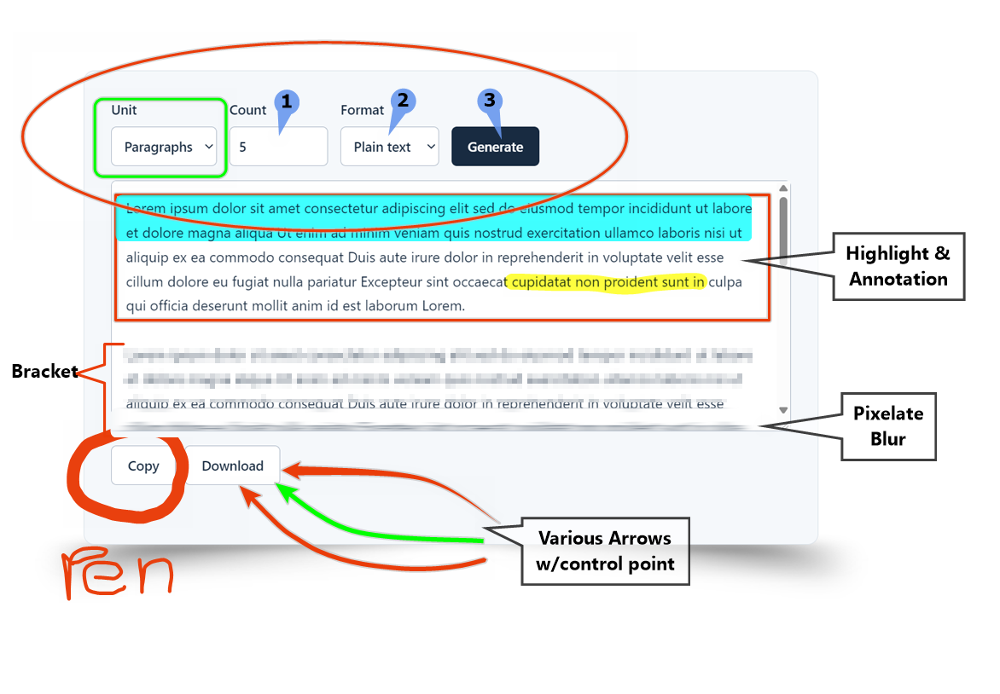

SnipShape supports **two methods for capturing a screen region**.

### One step capture - hold down activation keys

Current key assignments for screen selection (can be modified in the `SnipShape.ini` file)

| **Global HotKey** | **Action**                                                                                                                                                      |
| ----------------- | --------------------------------------------------------------------------------------------------------------------------------------------------------------- |
| Ctrl-Win          | Then drag a selection to create a snip                                                                                                                          |
| Alt-Win           | Then drag a selection to copy to the clipboard directly. You can click the tray message to edit the snip if desired or directly paste into your application. |

### Two Step capture - Hotkey to initiate snipping, then click-drag to select, similar to the built-in snipper

- Activation changes the cursor (and optionally dims/freezes the screen)
- Selection is done with mouse button-drag-release

| **Global HotKey** | **Action**                                                                |
| ----------------- | ------------------------------------------------------------------------- |
| Left Win-s        | Initiates a snip and changes the cursor to a cross.                       |
| Left Win-z        | Initiates a snip to copy to the clipboard (like the built-in capability). |
| Left Win-o        | Initiates an OCR of the user selection.                                   |

### While dragging the mouse to create a snip

- Holding the `Shift` key down forces a square capture.
- Holding the `Space` bar or the right mouse button down lets you shift the entire box as you draw it.
- The `Esc` key aborts the snipping operation.
- If the selected area is very small, the snip is ignored.

### Other snipping actions that don't use the mouse

| **Global HotKey** | **Action**                                                                                                                                                                                       |
| ----------------- | ------------------------------------------------------------------------------------------------------------------------------------------------------------------------------------------------ |
| Shift-PrtScn      | To capture the current window to the clipboard (Windows 11 rounded corners are transparent)                                                                                                      |
| Alt-PrtScn        | To create a snip of the current window (Windows 11 rounded corners are kept and the snip border follows them)                                                                                    |
| Ctrl-PrtScn       | To create a snip of the current monitor screen                                                                                                                                                   |
| Shift-Win-e       | To create a snip of the current clipboard: its image, or if there is none, each image file copied to the clipboard (e.g. Ctrl-C on picture files in Explorer)                                    |
| Shift-Win-c       | To copy the selection to the clipboard and create a snip of it: an image, or the selected image files (e.g. in Explorer). The original clipboard is restored unless Auto Update Clipboard is on. |

Image files opened this way (png, jpg, bmp, gif, ico, wmf, tif) load like File Open: a snip saved by SnipShape
reopens with its shapes still editable.

### Hotkeys on Snip Surface

Right-clicking a blank area of a snip shows a menu of various snip actions. Below are some additional hotkeys that work on the active snip surface.

One option is to paste in a small picture from the Stickies subfolder of the distribution, with the toolbar's **Picture Shapes** button (see [Picture shapes](#picture-shapes-stickies)). You can add/remove your own bitmaps in the Stickies folder created during installation.

| **Snip HotKey**          | **Snip Action**                                                                                                          |
| ------------------------ | ------------------------------------------------------------------------------------------------------------------------ |
| Ctrl-C                   | Copy the snip and shapes to the clipboard (minimizing snip), see [Copying and saving](#copying-and-saving)              |
| Ctrl-X                   | Cut the snip and shapes to the clipboard (closing snip)                                                                  |
| Ctrl-S                   | Save the snip and shapes to a file in the Screenshot folder                                                              |
| Ctrl-J                   | Save the snip to both the clipboard and Screenshot folder                                                                |
| Ctrl-V                   | Try to paste a new picture shape from the clipboard as either a bitmap (if available), or text (if bitmap not available) |
| Ctrl-P                   | Open a dialog box to add a picture from a file as a new shape                                                            |
| Ctrl-D                   | Clone the current snip and shapes if on the snip background; if focus is on a shape, duplicate the shape                 |
| Shift-Del                | Remove all the shapes on a snip                                                                                          |
| Ctrl-A                   | Select all the shapes on the snip as a group, see [Selecting a group of shapes](#selecting-a-group-of-shapes)            |
| Shift-Drag               | Select the shapes inside the dragged rectangle as a group (Ctrl+Shift-Drag in a drawing mode)                            |
| Shift-Click on a shape   | Add the shape to the group, or take it out if it is already in                                                           |
| Ctrl-Drag                | Drag a copy of the snip and shapes into another app (Explorer, Word, a browser upload box...), see [Dragging a snip into another app](#dragging-a-snip-into-another-app) |
| Ctrl-O                   | OCR the text to lines of text                                                                                            |
| Ctrl-T                   | OCR the text to an HTML table                                                                                            |
| Ctrl-I                   | Invert the Snip Colors                                                                                                   |
| Ctrl-B                   | Black and White the Snip Colors                                                                                          |
| Ctrl-G                   | Grayscale the Snip Colors                                                                                                |
| Ctrl-L                   | Stretch Contrast of the Snip                                                                                             |
| Ctrl-Z                   | Undo the last snip action                                                                                                |
| Ctrl-Y                   | Redo the last undo action on the snip                                                                                    |
| Ctrl-Down                | Minimize all Snips                                                                                                       |
| **Snip HotKey**          | **Scaling Action**                                                                                                       |
| = / -                    | Zoom in or out of Snip to enlarge/reduce its size                                                                        |
| Ctrl-Scroll Wheel        | Zoom in or out of Snip to enlarge/reduce its size                                                                        |
| Alt-Scroll Wheel         | Adjust the transparency (Alpha) of the visible snip bitmap. It is kept when copying/saving and restored when a saved snip is reopened |
| RMB (Right Mouse Button) | Brings up a menu with additional options for the snip                                                                    |
| Esc                      | One step at a time: cancels a shape bar slider drag, clears a group or deselects a shape, leaves the drawing mode, then closes the snip |

#### Copying and saving

Copying (Ctrl-C, Ctrl-X, Ctrl-J) and saving (Ctrl-S) build the image from the snip and its shapes directly rather than
taking a screen capture, so:

- Other windows, tooltips, the toolbar or the focus rectangle covering the snip never end up in the image.
- The snip's transparency (Alt-Scroll) is kept: a 50% transparent snip copies/saves as 50% transparent. Shapes and the
  border stay opaque, as they appear on screen.
- Transparent rounded corners (e.g. from a Windows 11 window capture) stay transparent.
- Saved snips remember their transparency and restore it when reopened for editing.
- Copied, dragged and saved pictures record the DPI of the monitor the snip is on, so Office and other apps that use
  it show the picture at the size it appears on screen (including on high-DPI and mixed-DPI setups).

#### Dragging a snip into another app

Hold Ctrl and drag on an empty part of the snip (in any mode) to drag a copy of it into another application. The snip
itself stays where it is; only the cursor moves, with a small picture of the snip under it. Press Esc to cancel.

- The image is the same one Ctrl-C copies (snip plus shapes, with the border if "Include Border With Clipboard Copy" is
  checked).
- Apps that take pictures (Word, Outlook, Paint, OneNote...) get the image directly. Explorer, browser upload boxes and
  mail/chat attachments get a PNG file named after the snip, written to `%TEMP%\SnipShape\Drag`. Those files are kept
  until SnipShape next starts, since some apps (browsers) read the file after the drop.
- Dropping on another snip opens the picture as a new snip; dropping it back on itself does nothing.
- Apps running as administrator won't accept drops from SnipShape unless it runs as administrator too (a Windows rule).
- Ctrl-click on a shape still duplicates the shape, and Ctrl+Shift-drag still selects a group in a drawing mode.

## Toolbar - F1 to toggle while snip active, Sample ShapeBars shown on right

<table>
  <tr>
    <td rowspan="6" valign="top">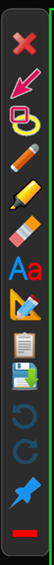</td>
    <td>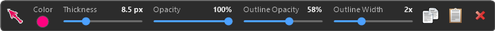</td>
  </tr>
  <tr><td>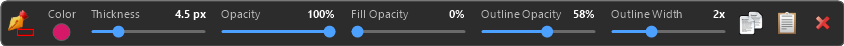</td></tr>
  <tr><td>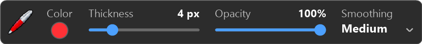</td></tr>
  <tr><td>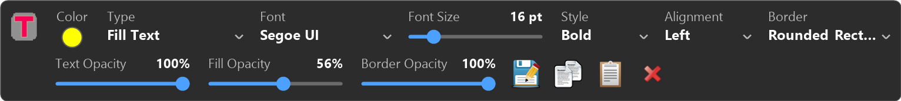</td></tr>
  <tr><td>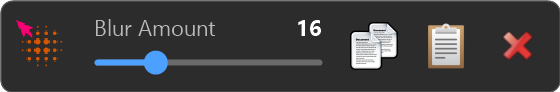</td></tr>
  <tr><td></td></tr>
</table>

A toolbar can appear to the left of each active snip to provide quick access to common actions and annotation tools.

### Show or hide the toolbar

- Press `F1` while a snip is active to toggle the toolbar on or off.
- The **X** button at the top closes the snip (not the toolbar).

### Use toolbar buttons

Each toolbar button represents a shape or tool.

- Click (left or right) a category button to open its list of shapes, and pick the shape or tool to draw next.
- A shape's settings (thickness, opacity, fonts, ...) are on the [shape bar](#shape-bar) that appears once a shape is
  picked: changing them there sets the default for new shapes of that kind.

The toolbar is helpful if you prefer selecting tools visually instead of using keyboard shortcuts.

### Picture shapes (stickies)

The **Picture Shapes** button (between Text and Tool) opens a bar of small icons, one for each picture in the
Stickies folder (`IconPath` in the settings file). The folder is read each time the bar opens, so pictures you add
or remove show up at once.

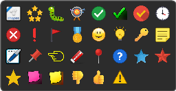

- Click a picture: the bar closes and the cursor becomes that picture. Click on the snip to place it there (centred on
  the click). Esc, or choosing a drawing tool, cancels.
- The first icon opens a file dialog to add pictures from any folder (same as Ctrl-P).
- Esc, the button again, or a click on the snip closes the bar without picking. Drag its background to move it.

### Toolbar behavior

- The toolbar automatically moves to the currently active snip.
- If focus changes to a non-snip window, the toolbar hides automatically.
- When focus returns to a snip, the toolbar reappears.
- Using the toolbar doesn't take the focus from the snip: the drawing tool stays on (for example Undo or Copy while
  drawing), and Esc still works on the snip. A shape picked from a toolbar menu is ready to draw at once.
- Drag the toolbar's background to move it out of the way (until the snip is next activated).
- The toolbar is on the left of the snip, starting at its top corner. When there is no room there it moves to the right
  side, and a toolbar taller than the space below is moved up to stay on the monitor.
- To have the toolbar horizontally above the snip instead, set `Orientation` in the settings file (see below).

### Shape bar

A horizontal **shape bar** appears above the snip while a drawing tool is selected or shapes are selected. It shows the
properties that apply: color, thickness, opacity, outline, blur amount, fonts and so on.

#### Defaults for new shapes, or just the selected shapes

With a drawing tool on, the bar sets the defaults for new shapes. With shapes selected, it changes only those shapes. When
the bar has the copy and delete buttons, you are changing selected shapes.

| When                                                          | Sets the default for new shapes | Shapes changed     |
|---------------------------------------------------------------|---------------------------------|--------------------|
| A drawing tool is selected                                    | Yes                             | None yet           |
| A drawing tool is selected and you just drew a shape with it  | Yes                             | The last one drawn |
| One shape is [selected](#selecting-a-shape)                   | No                              | That shape         |
| A group is selected (Shift-drag, Shift-click or Ctrl-A)       | No                              | All in the group   |

- Changes to shapes can be undone, including their stacking order (send to back, send backwards, and a shape brought
  to the top by clicking it). Undo does not change a default back.
- The last shape drawn is no longer changed once you pick another tool, leave drawing mode, or delete or undo it. Text
  shapes other than tags leave drawing mode when you enter the text, so select those to change them.
- Smoothing and Numbering only apply to new shapes.
- A group shows the properties that all its shapes share. A change sets every shape to the same value in one undo step.
  *Mixed* means the shapes have different values. Shapes with nothing in common show only copy, delete and, if any of
  them has one, the color.
- If a group is selected while a drawing tool is on, the bar changes the group.
- Defaults are remembered when SnipShape is closed.

Some defaults are shared by several kinds of shape:

| Default                    | Shared by                                                                            |
|----------------------------|--------------------------------------------------------------------------------------|
| Color                      | The kind of shape, see [Colors](#colors)                                             |
| Thickness                  | All arrows; lines and boxes; Highlighter, Whiteout and Smudge pens. Pen and Wide Pen have their own |
| Opacity                    | All arrows; lines and boxes; Pen and Wide Pen; highlighters (on light backgrounds only: a highlight over a dark background is always full strength) |
| Outline opacity and width  | Arrow, double, tapered and arc arrows, and boxes, together (a width of 0 is no outline) |
| Blur amount                | Blur, Gaussian Blur and Smudge                                                       |
| Font, size, style, alignment | Text, Fill Text and Arrow Text. Outline Text and Tags have their own               |
| Text opacity               | All text except tags                                                                 |

#### Using the bar

- **Color**: click to choose from the [color popup](#color-menu-lmb-to-select-color-rmb-to-customize-color). While
  drawing it is the color of that kind of shape, see [Colors](#colors). Several dots mean the selected shapes have
  different colors. Right-click it and choose **Use This Color for All New Shapes** to make the color shown the default
  for every kind of shape except highlighters (not offered when it shows several colors).
- **Sliders**: drag the knob, click the track, or turn the mouse wheel over it. Press `Esc` while dragging to put the old
  value back. Right-click for a list of preset values.
- **Lists** (font, style, alignment, ...): click to choose, or turn the mouse wheel over it.
- **Type**: for selected text shapes, changes them to another text type (Text, Fill Text, Outline Text, Tag, Left/Right
  Arrow Text). The text, font and color are kept, the shapes stay centered where they were, and a single undo changes
  them back. It doesn't react to the wheel.
- **Edit** (for a selected text shape): edit the text, the same as Alt-click.
- **Rotate and flip** (for a selected picture shape): rotate +90 / -90, flip left/right / top/bottom. Each can be
  undone.
- **⋯ (More)** (for one selected shape): a menu of the less used actions; its tooltip lists them. Only the ones that
  apply are there:
  - **Reset Size / Reset Picture Size / Reset Font Size**: puts a pen stroke back to the size it was drawn at, a
    picture back to its own size, or a text shape back to its original font size. Undo puts it back.
  - **Send to Back / Send Backwards** (when the snip has other shapes): moves it below all the other shapes, or one
    step down (the same as Alt-Click). Undo puts it back where it was.
  - **Transparent Background** (pictures): makes the picture's background color (the color around its edges)
    transparent. Undo puts it back.
- **Duplicate** (left of the clipboard icon, for one selected shape): the same as Ctrl-D. The copy is then selected, so
  clicking again makes another copy from it. Undo removes it.
- The bar moves below the snip when there is no room above it. Drag its icon to move it out of the way.
- `F1` shows or hides the shape bar together with the toolbar.

## Drawing on snips

SnipShape provides a variety of annotation tools.

You can activate drawing modes by:

- pressing a **hotkey**
- selecting a tool from the **toolbar**

While drawing, the cursor changes to the selected shape and the snip border indicates the active color.

### Snip Hotkeys to create shapes

## Arrow shapes

| Key   | Action                                                  |
| ----- | ------------------------------------------------------- |
| A     | Creates an arrow from end to arrowhead, with an outline (set the outline width to 0 on the shape bar for none) |
| &#92; | Creates a tapered outline arrow from end to arrowhead   |
| J     | Creates a freehand outlined arc arrow (with slow bends) |
| /     | Creates a double outline arrow                          |

The plain (never outlined) arrow that V used to draw is gone: use Arrow with an outline width of 0. Plain arrows in
saved snips still open and can be edited.

## Shape tools

| Key | Action                                                                            |
| --- | --------------------------------------------------------------------------------- |
| L   | Creates a line, shift to keep on an axis                                          |
| R   | Creates an outlined rectangle, shift to keep square                               |
| D   | Creates an outlined rounded rectangle, shift to keep square                       |
| E   | Creates an outlined ellipse/circle, shift to keep a circle, draws from center out |
| [   | Creates a connector line (vert/horz segments only)                                |
| ]   | Creates a bracket/brace                                                           |

## Freehand drawing

| Key | Action                                                                 |
| --- | ---------------------------------------------------------------------- |
| P   | Free-hand Pen in current color, shift to stay on an axis               |
| M   | Free-hand Wide (Marker) Pen in current color, shift to stay on an axis |

## Highlighters

| Key | Action                                                             |
| --- | ------------------------------------------------------------------ |
| H   | Free-Hand Highlighter starting in yellow, shift to stay on an axis |
| Y   | Yellow highlighter block                                           |

## Redaction and obscuring

| Key | Action                                                                |
| --- | --------------------------------------------------------------------- |
| W   | Free-Hand White Out Pen in background color, shift to stay on an axis |
| S   | Free-Hand Smudge Pen to blur underneath, shift to stay on an axis     |
| X   | Block/Redact rectangle with color under the cursor                    |
| I   | Pixelate Rectangle, good for text obscuring                           |
| B   | Blur Rectangle, good for photo obscuring                              |
| G   | Gaussian Blur Rectangle, good for text obscuring                      |

## Text tools - Text is entered via a dialog box allowing you to set text options

| Key        | Action                                                                                   |
| ---------- | ---------------------------------------------------------------------------------------- |
| N          | Increasing Numbered tag on click, resets when no text shapes exist, Alt key for 2x size. Hold the button and drag to pull out a callout (the tag stays where you clicked). Labels can be numbers, upper or lower case letters, or Roman numerals (**Tag Number Scheme** on the shape bar while the Tag tool is picked). RMB on a tag > **Renumber Tags** closes gaps after deleting one, **Tag Scheme** changes the scheme |
| T          | Add Text to cursor location                                                              |
| U          | Add Outline Text to cursor location                                                      |
| F          | Add Text with adaptive translucent background to stand out from busy backgrounds         |
| <          | Text inside a left-pointing arrow                                                        |
| >          | Text inside a right-pointing arrow                                                       |

### Callouts

<!-- Screenshot: a Tag, a bordered fill text and a plain text, each with a callout pointing at something -->

Text shapes (Tag, Text, Outline Text and Fill Text) can point at something with a callout. Arrow text does not
have one, since it already points.

- Each of these shows a small round handle inside its box (near the bottom center) when it has focus.
  Drag that handle out of the box and a callout follows it to where you release. Drag it back inside the box to
  remove the callout.
- The callout style depends on the text type:
  - **Tag**: the circle and its tail form a filled pin.
  - **Fill Text with a border** (Rectangle / Rounded Rectangle / Ellipse): a triangular tail with the same fill, and one border
    running around both the box and the tail.
  - **Text, Outline Text and Fill Text without a border**: a straight arrow in the text color, from the edge of the
    box to the tip.
- Moving a callout:
  - Drag the **text box** to move just the text; the tip stays where it points.
  - Drag the **tip handle** to move just the tip.
  - Drag the **arrow/tail** itself to move the whole callout (text and tip together).
- Resizing the text, undo/redo, duplicating (Ctrl-click) and saving/reopening all keep the callout.

## Colors

| Key        | Action                                                                                   |
| ---------- | ---------------------------------------------------------------------------------------- |
| 1-9        | With a drawing tool selected: the color of that kind of shape. In select mode: the color of all kinds. While drawing, moving or resizing a shape: that shape's color. With a group selected: recolors the group only. |

Arrows, shapes (lines and boxes), free hand pens, text, tags and highlighters each have their own color for new shapes,
which is remembered.

- The **shape bar** color and the number keys set the color of the kind of shape you are drawing.
- The number keys in select mode set the color of all kinds at once, except the highlighters. So does right-clicking
  the color on the shape bar and choosing **Use This Color for All New Shapes**.
- With a group selected, the keys and the shape bar color recolor the group and leave the colors for new shapes alone.
- Redact shapes take their color from the picture.

## Snip Tools

| Key | Action                                                                          |
| --- | ------------------------------------------------------------------------------- |
| C   | Cropping rectangle to make the current snip smaller by cropping it to selection |
| O   | OCR the selected area                                                           |
| K   | Slice out the selected area of the snip                                         |
| Q   | Extend the snip using the background color under the cursor                     |

### Toolbar Menus to create shapes

#### Arrow Shapes

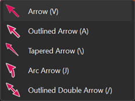

#### Line/Connector/Rectangle/Ellipse Shapes/Bracket

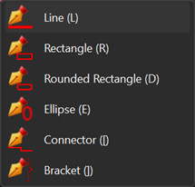

#### Free pen shapes

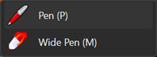

#### Highlighter shapes

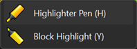

#### Redact/Obfuscate shapes

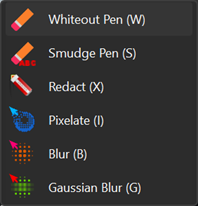

#### Text shapes (text/tag/fill/outline/arrow text), Text entered via a dialog box.

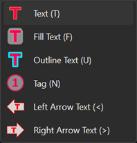

#### Tool menu

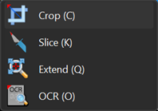

#### Color menu, LMB to select color, RMB to customize color

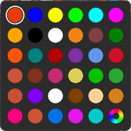

This color popup opens from the **Color** cell of the [shape bar](#shape-bar) (the toolbar no longer has a color
button). What the color applies to depends on what the bar is showing: the kind of shape being drawn, the selected
shape, or the selected group (see [Colors](#colors)).

- Left-click a color to use it.
- Right-click a color to change it with the color dialog, or Ctrl+right-click to pick the new color from the screen.
  The 36 colors are kept in the settings file (`[User Shape Color]`).
- The ring marks the current color.

### Drawing/Resizing Shapes

- Extra padding is provided outside the snip surface to allow shapes to extend beyond the snip boundary.
  Once drawn, only the portion within the snip will be shown (adjustable in `SnipShape.ini`).
- While in draw mode:
  - Single-click on the snip surface (or press Esc) to switch back to select mode.
  - Hold Space and move the mouse to pan the snip; release Space to resume drawing.
- When drawing or resizing:
  - Hold Space to shift the start location with the mouse (except freehand).
  - Press Up/Down arrow keys to increase/decrease line thickness for shapes with edges, lines, or freehand paths.
  - Hold Alt for a 2x thicker border, pen/text size, or blur amount on most shapes.
- When drawing rectangles or ellipses, hold Shift to constrain width/height equally (i.e., square/circle).
- When drawing or resizing lines or arrows, the shape snaps at 45° angles or to nearby line endpoints.
- When drawing freehand shapes:
  - Hold Shift to keep the line straight; release to resume freehand. Use this to draw connected line segments
    by pausing at each corner, releasing Shift, then pressing it again before continuing.
  - If you end the path near its starting point, the path will automatically close itself.

### Reshaping shapes (control points)

<!-- Screenshot: a bent arrow, a bracket with a moved notch, and a connector with a moved middle segment -->

Some shapes have an extra round handle (a control point) in addition to the resize handles. Dragging it reshapes the
shape instead of resizing it. Undo/redo, duplicating and saving keep the new shape.

| Shape                                   | Control point                    | Dragging it                                                                                     |
| --------------------------------------- | -------------------------------- | ----------------------------------------------------------------------------------------------- |
| Line, Arrow, Outline Arrow, Double Arrow, Tapered Arrow | Middle of the line | Bends the line into a smooth curve through that point. Drag it back near the straight line to straighten it again. Arrowheads follow the curve. |
| Bracket                                 | Tip of the center triangle       | Along the bracket moves the triangle; away from or towards the bracket makes it deeper or shallower. |
| Connector                               | Middle of the center segment     | Slides the middle segment left/right (or up/down), between the two ends.                        |
| Text shapes                             | Callout tip                      | See [Callouts](#callouts).                                                                       |

## Hovering and Focus Rectangle

<table>
   <tr>
      <td align="center"></td>
      <td align="center"></td>
   </tr>
   <tr>
      <td align="center">Body Shapes</td>
      <td align="center">Line Shapes</td>
   </tr>
</table>

- When you hover over a shape, a focus rectangle appears around it. This
indicates the shape can be moved, resized, or adjusted. The cursor will change
to a resize icon or open hand icon depending on where you hover.
- Resize a shape by clicking and dragging one of the resize handles (shown with
the resize cursor). All shapes and text objects can be resized this way.
- Move a shape by clicking and dragging the focus rectangle when the hand cursor is displayed.
- When hovering, use the arrow keys (Up, Down, Left, Right) to move the shape without using the
mouse. Movement snaps to the grid.
- When hovering, use the mouse scroll wheel to adjust properties of the shape under the mouse:
  - Line thickness for drawn shapes
  - Text size for text shapes
  - Blur or pixelation level for obscure shapes
- Arrow key and scroll wheel changes can be undone. A run of key presses or wheel notches is a single undo step.
- Everything for one shape is on its [shape bar](#shape-bar): click the shape to select it. Right-clicking a shape
  only offers what acts on more than that shape: **Renumber Tags** and **Tag Scheme** for tags, and **Clear Shapes**
  (Shift-Del) when the snip has several. With none of those, there is no menu. You can also use keyboard shortcuts to
  perform operations on the shape.

While hovering over a shape, you can also use the hotkeys listed below to perform additional actions.

### Selecting a shape

Clicking, moving or resizing a shape in select mode also selects it. Its focus rectangle and handles then stay on when the
mouse moves away, and the [shape bar](#shape-bar) shows its properties.

- You can still hover over any other shape to move or resize it without selecting it first. The focus rectangle goes to
  the shape under the mouse and returns to the selected shape afterwards; pressing the mouse on a shape selects that one.
- With the mouse away from any shape, Del, the arrow keys and Ctrl-D act on the selected shape. The mouse wheel only
  changes a shape under the mouse.
- Shift-click another shape to make a group of both.
- Deselect with Esc (a second Esc closes the snip), a click on the snip background, a drawing tool, or by switching to
  another snip or program.

The hotkeys while hovering over a shape, or with one selected:

### Hotkeys on Shapes

| **Shape HotKey**     | **Action**                               |
| -------------------- | ---------------------------------------- |
| Ctrl-Click Ctrl-D | Duplicate the shape.                     |
| Shift-Click          | Add the shape to the group selection, or take it out if it is already in. |
| Alt-Click            | Edit a text shape; on other shapes, push the shape down one level. |
| Del                  | Remove the shape.                        |
| Arrow keys           | Move the shape (snaps to the grid). While dragging a resize handle, Up/Down change the thickness instead. |
| Esc                  | Deselect the selected shape (a second Esc closes the snip). |
| 1 to 9               | While moving or resizing the shape: apply the associated color to it. |
| Scroll up/down       | Adjust thickness or obfuscation amount.  |

### Text / Graphics

- Press T or U over a snip to open a dialog box and add text at the current mouse location.
- Press Ctrl-P over a snip to select a graphic from a folder and add it at the current mouse location.
- Use the toolbar's Picture Shapes button to pick a sticky and click where it goes, see [Picture shapes](#picture-shapes-stickies).

### Moving Shapes

- Grab one of the sides or the object itself to move it around.

### Deleting Shapes

- If the focus rectangle is active and a shape is highlighted, the Del key removes it.
- Shift-Del removes all shapes on a snip.
- RMB on the snip area and select Clear all Shapes (Shift-Del) in the menu.

### Resizing Shapes

- Enabling the focus rectangle helps locate edges and resize points.
- Grab a corner to resize in that direction; the Shift key maintains the aspect ratio (or square/linear).
- While resizing shapes, you can use Up/Down to change the line thickness (when it applies).

### Clicking on Shapes

- The right mouse button on a shape brings up a shape-specific menu with additional functions.
- On a numbered Tag, **Renumber Tags** renumbers the snip's numbered tags 1, 2, 3... in their current order, closing any
  gaps left by deleted tags. Tags whose text you edited to something else are left alone, each tag stays where it is, the next
  tag you add continues the sequence, and a single undo restores the old numbers.
- **Tag Scheme** (next to Renumber Tags) switches all of the snip's numbered tags between Numbers (1, 2, 3), Upper
  Case (A, B, C), Lower Case (a, b, c) and Roman (I, II, III). Each tag keeps its place in the order and stays where it
  is, and a single undo changes them back. Letters continue past Z as AA, AB, ... New tags on a snip continue the
  scheme its tags already use; the default for a snip with no tags is **Tag Number Scheme** on the shape bar while the
  Tag tool is picked. Renumber Tags keeps each tag's scheme.
- Thickness, blur amount, opacities and outline are on the [shape bar](#shape-bar): click the shape to select it. You can
  also use the mouse wheel (when hovering), or the Up/Down keys while dragging a resize handle.
- Ctrl-click to clone a copy of the object (except for freehand shapes), or press Ctrl-D on a shape
- Shift-click to add the shape to the group selection (starting one if needed), or to take it out of the group
- Alt-click a text shape to edit its text (Alt-click on any other shape pushes it down one level)
- OCR - Uses Descolada's OCR engine to read text from a snip
  - Read lines of text, with line breaks as shown
  - Read words of text, with line breaks only at paragraph breaks (good for pasting)
  - Read table text attempting to create an HTML table that represents each cell (with limitations)
  - Press O (or button-bar icon) to select a region of a snip to put the OCR on the clipboard

### Selecting a group of shapes

<!-- Screenshot: a dashed group box around several shapes, with its right-click menu -->

Shift-drag on an empty part of the snip to draw a selection rectangle (in a drawing mode, use Ctrl+Shift-drag, since
Shift alone squares the shape you draw). Every shape fully inside the rectangle is selected, and a dashed box is drawn
around the group. For a callout, its tip has to be inside the rectangle too. Ctrl-A selects every shape on the snip.

Shift-click a shape to add it to the group (this starts a group if there isn't one), and Shift-click a shape in the
group to take it out; taking out the last one clears the group. This works on shapes under the group box too. It only
applies in select mode (no drawing mode), and a Shift-click on a shape's resize handle still resizes it, keeping the
aspect ratio.

| Action                     | Result                                                                                       |
|----------------------------|----------------------------------------------------------------------------------------------|
| Drag inside the box        | Moves all the shapes together (callout tips move with their text)                            |
| Up/Down or the mouse wheel | Changes each shape's size the way it does for a single shape: line width, font size, blur amount |
| 1-9 color keys             | Recolors the group                                                                           |
| Del                        | Deletes the group                                                                            |
| Ctrl-C                     | Copies the group, with the snip picture under it, to the clipboard                           |
| RMB on the box             | Menu: copy (with the picture, or the shapes only on a transparent background), delete |
| Esc, or click outside the box | Clears the selection                                                                      |

Each of these is a single undo step. Pictures and blur/pixelate shapes are moved, sized and deleted with the group but
keep their own colors.

## Tray Menu options

Left-clicking the SnipShape tray icon brings up the following choices:

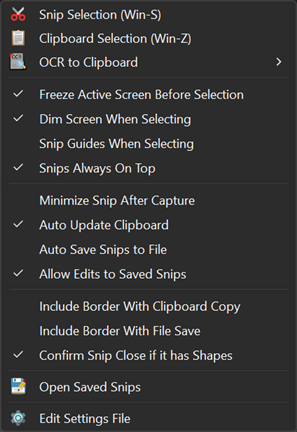

- Initiate snip or clipboard selection
- OCR selection to clipboard (Words, Lines or Table)
- Freeze Screen Before Selection (toggle)
- Dim Screen When Selecting - similar to the built-in snipping tool (toggle)
- Show snip guides when selecting (toggle)
- Snips Always On Top (toggle)
- Confirm Snip Close if it has Shapes (toggle)
- Auto Update Clipboard on snip (toggle)
- Auto Save clips to the screenshot folder on snip (toggle)
- Include Border With Clipboard Copy (toggle)
- Include Border With File Save (toggle)
- Open Saved Snips dialog to retrieve a previously saved snip or screenshot; if the snip has shapes, they will be editable when reopened
- Edit Settings File in Notepad to edit additional settings

## Configuration Files

- By default a configuration file called SnipShape.ini is created in your local AppData folder.
- Most of the options are set via the Tray Menu and Toolbar; however, some options can only be changed by editing the file. A restart is required after changing these. You can edit the SnipShape.ini file directly from the tray icon menu `Edit Settings File`.
  - `[User Shape Color]`, the colors of the color popup, 1 through 36. Named colors or hex RGB (e.g. 0xCE1126) are allowed.
  - `[User Snips]`, location of the cursor files, saved snip files and icon clips that are available from the snip menu.
    - `SnipPath` - default is user\Pictures\Screenshots folder
    - `IconPath` - default is Stickies subfolder of installation, these are small images that can be pasted on a snip from the snip menu.
    - `CursorPath` - default is the Cursors subfolder of the installation, these are used as icons & cursors throughout the program.
    - `Border Width` is used to adjust width of snip borders. Fractional sizes are allowed. Default is 2.0.
    - `Vertical Sync on Select` - Set to 1 to prevent rectangle artifacts when drawing. Only needed if they appear on your system. Default is 0.
  - `[User Shapes]`, Shape related settings.
    - `ScaleFreehand` - Set to 1 to also scale line width when scaling a line based shape. Default is 0 for no scaling.
    - `Padding` - Amount of padding in pixels outside the snip to allow shapes to be drawn. Default is 450 pixels.
  - `[User Button Bar]`, size and placement of the button bar
    - `Font Size` - increase or decrease to change the size of the toolbar, the shape bar and the color popup together. Default is 8.0. Fractional sizes are allowed.
    - `Orientation` - `Vertical` (left of the snip) or `Horizontal` (above the snip). Default is Vertical.
  - The Tray menu allows you to edit these directly in Notepad.
- Optional key bindings: these are defaults, so they aren't shown in the file unless you add them. Select Edit Settings File from the tray menu to add them.

- Below are the various global hotkeys and their default values.

| `[Hotkey]`                       | Description                                                                                         |
| -------------------------------- | --------------------------------------------------------------------------------------------------- |
| `ClipActiveWindow=+PrintScreen`  | Copy the active window to the clipboard.                                                            |
| `SnipActiveWindow=!PrintScreen`  | Create a snip of the active window.                                                                 |
| `SnipActiveMonitor=^PrintScreen` | Create a snip of the active screen                                                                  |
| `EditClipboard=+#e`              | Create a snip of the clipboard image, or of each image file copied to the clipboard                 |
| `SnipAndEditClipboard=+#c`       | If there is an active selection, copy it and create a snip of it (an image or selected image files) |
| `ShowHideAllSnips=!F12`          | Toggle view state of any active snip windows (minimize/restore)                                     |
| `SnipArea2Step1=<#S`             | Start a snip of an area of the screen using the two step method                                     |
| `ClipArea2Step=<#Z`              | Start the clipboard capture of an area of the screen using the two step method                      |
| `OCRArea2Step1=<#O`              | Start an OCR of an area of the screen using the two step method                                     |
| `SnipArea1Step1=^#Lbutton`       | Start a snip of the screen using the one step method (keep hotkey down while dragging)              |
| `ClipArea1Step1=!#Lbutton`       | Start a clipboard capture of the screen using the one step method (keep hotkey down while dragging) |

## Limitations/Future

- One Arrow type in place of Arrow and Outlined Double Arrow, with the arrow ends chosen on the shape bar (the plain
  arrow is already folded into Arrow)
